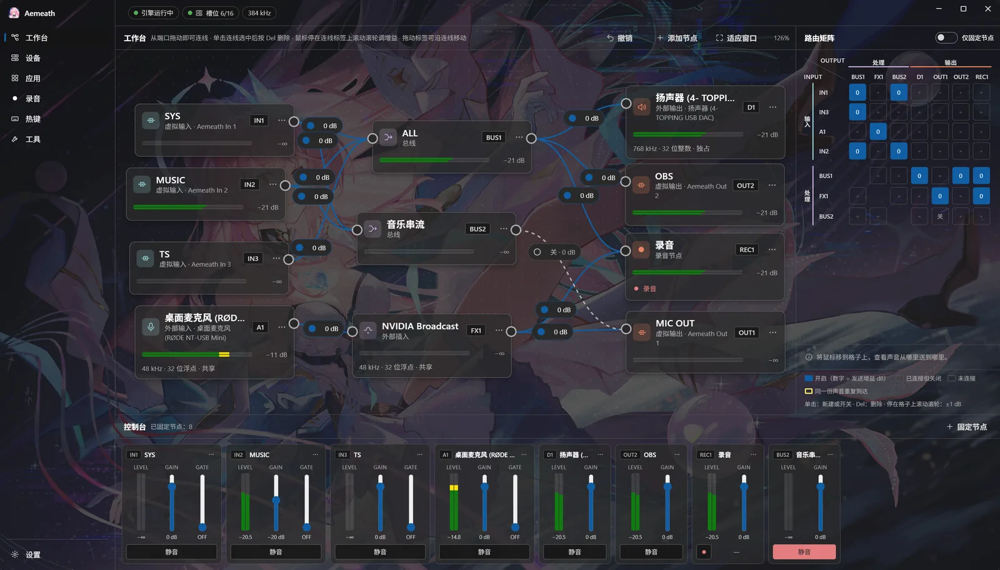

<h1 align="center">
    <br>
    
    <br>
    Aemeath
    <h4 align="center">
        A whimsical virtual audio console that untangles the audio input/output mess in Windows
    </h4>
    <h4 align="center">
        <a href="http://www.apache.org/licenses/LICENSE-2.0">
            
        </a>
        <a href="https://github.com/Hoshikawa-Kaguya/Aemeath/actions/workflows/ci.yml">
            
        </a>
    </h4>
</h1>

<div align="center">
    
</div>

[中文](README.md) | English



## Features

- **Node-graph workbench**: wire inputs, buses and outputs together freely, with a routing matrix and a console view for quick adjustments.
- **Built-in virtual devices**: no third-party virtual cables needed. Aemeath provides 8 virtual inputs (`Aemeath In 1–8`) and 8 virtual outputs (`Aemeath Out 1–8`), built on [usbip-win2](https://github.com/vadimgrn/usbip-win2) and the USB audio class driver that ships with Windows — no test signing and no disabling Secure Boot.
- **Per-app routing**: send each app's audio into its own virtual input, or duplicate an app's audio while it keeps playing normally.
- **External inserts**: route audio through external processors such as NVIDIA Broadcast and pull it back in.
- **Recording and hotkeys**: recorder nodes write WAV or FLAC directly; mute, connection toggles and recording can all be bound to global hotkeys, including mouse side buttons.
- **High quality**: 32-bit float processing internally; device formats up to 384 kHz (768 kHz in exclusive mode); every sample-rate conversion happens inside Aemeath, with a choice of resamplers.
- **Low latency**: external devices open in WASAPI exclusive mode by default, with per-device format and buffer settings; individual devices can be switched to shared mode.

## Requirements

- Windows 11 x64
- AVX2 x64 CPU
- usbip-win2 driver: bundled with Aemeath and installed through a first-run guide

## Download

Grab a build from the [Releases](https://github.com/Hoshikawa-Kaguya/Aemeath/releases) page:

- **Installer**: `Aemeath-win-Setup.exe`. Run it and you are done.
- **Portable**: `Aemeath-win-Portable.zip`. Unzip and run `Aemeath.exe`. Settings live in `%APPDATA%\Aemeath` here as well. Before deleting the portable folder, run "Remove virtual devices" on the settings page.

Both builds can check for and install updates from the settings page.

See [usage](docs/usage.en.md) for the walkthrough, and [`GLOSSARY.md`](GLOSSARY.md) for terminology (in Chinese).

## Development

You need Rust (stable, 1.90 or newer), Node.js 22.12 or newer, and pnpm (the version is pinned by `packageManager` in `app/package.json`).

```sh
cd app
pnpm install
pnpm tauri dev                # run the app with frontend hot reload
pnpm tauri build --no-bundle  # release build; installers are packaged separately by Velopack
```

The app only produces sound while the engine is running and connected. Normally the guardian starts both: it brings up the engine and then the app. During development you can also start the engine yourself (`cargo run -p aemeath-host`) and then launch the app. With no arguments, both derive the same data directory (`%APPDATA%\Aemeath Dev`), pipe names and shared-memory names from the dev identity. Dev devices are named `Aemeath Dev In/Out N` and never mix with devices from a real installation.

If you only need to iterate on the frontend, run `pnpm preview` in `app/`: it starts the dev server and opens `http://localhost:21364/preview.html`, where Tauri's `mockIPC` stands in for the backend (`src/dev/preview.ts`). This page is only served by the dev server and is not part of release builds.

Checks (the same set CI runs):

```sh
# in app/
pnpm format:check && pnpm lint && pnpm build
# at the repo root (run pnpm build once first: the app embeds app/dist at compile time)
cargo fmt --all --check
cargo clippy --workspace --all-targets -- -D warnings
cargo test --workspace
cargo deny check              # dependency licenses, advisories and sources
```

Fuzzing for the USB/IP parser lives in [`fuzz/`](fuzz/README.md).

Releases: the version number appears in two places, `scripts/version.json` and `[workspace.package]` in the root `Cargo.toml`. Push a `vMAJOR.MINOR.PATCH` tag and CI verifies the version, packages with `scripts/release.ps1`, and publishes to GitHub Releases.

Project layout:

| Path | Contents |
|---|---|
| `crates/` | Shared libraries: `aemeath-protocol` (IPC messages, routing topology, level shared-memory layout), `aemeath-sys` (Windows API wrappers, the only crate allowed to use `unsafe`), `aemeath-runtime` (command-line arguments and logging shared by the three processes) |
| `engine/` | Engine process: audio, resampling, master clock, USB/IP server |
| `app/` | Main app (Tauri 2): `src/` is the Vue 3 frontend, `src-tauri/` is the Rust backend, `crates/` holds the control-plane libraries |
| `guardian/` | Guardian process (`Aemeath.exe`): checks the driver, then starts and watches the engine and the app |
| `tools/` | Dev tools: `aemeath-dev-cleanup` (fully removes device instances created by the dev identity) |
| `fuzz/` | Fuzzing for the USB/IP parser (a separate workspace) |
| `scripts/` | Version and packaging scripts |

## License

[AGPL-3.0](LICENSE). Third-party components: [`THIRD-PARTY-NOTICES.md`](THIRD-PARTY-NOTICES.md).
