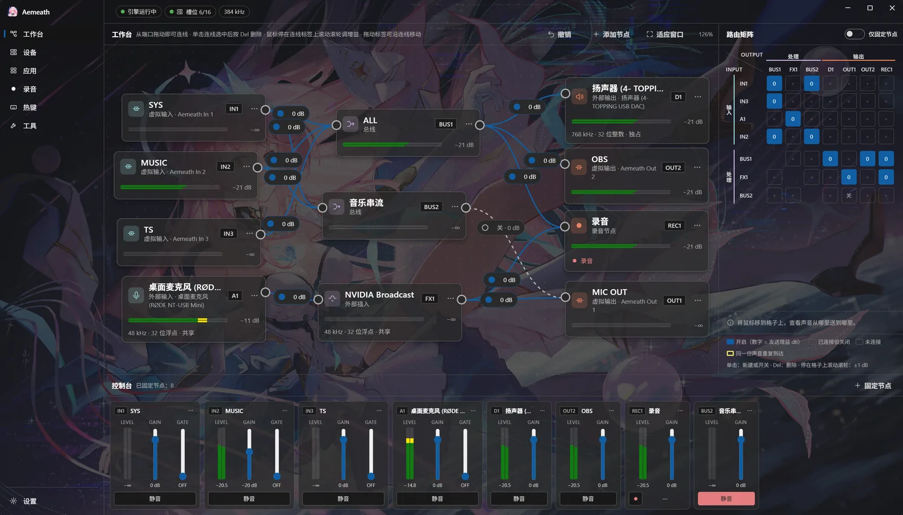

<h1 align="center">
    <br>
    
    <br>
    Aemeath
    <h4 align="center">
        一个神奇的妙妙虚拟音频控制台，帮你调整Windows中杂乱无章的音频输入/输出设备
    </h4>
    <h4 align="center">
        <a href="http://www.apache.org/licenses/LICENSE-2.0">
            
        </a>
        <a href="https://github.com/Hoshikawa-Kaguya/Aemeath/actions/workflows/ci.yml">
            
        </a>
    </h4>
</h1>

<div align="center">
    
</div>

中文 | [English](README.en.md)



## 特点

- **节点图工作台**：自由连接输入、总线和输出，另有路由矩阵和控制台两种快速调整的方式。
- **自带虚拟设备**：不需要另装虚拟线缆。Aemeath 提供 8 个虚拟输入（`Aemeath In 1–8`）和 8 个虚拟输出（`Aemeath Out 1–8`），通过 [usbip-win2](https://github.com/vadimgrn/usbip-win2) 和 Windows 自带的 USB 声卡驱动实现，不需要测试签名，也不需要关闭安全启动。
- **按应用分轨**：把不同应用的声音分别送进不同的虚拟输入，或者在应用照常播放的同时复制一份它的声音。
- **外部插入**：把声音送进 NVIDIA Broadcast 这类外部程序处理后再取回。
- **录音与热键**：录音节点直接写 WAV 或 FLAC；静音、连线开关、录音都可以绑定全局热键，支持鼠标侧键。
- **高品质**：内部 32 位浮点处理；设备格式最高 384 kHz（独占模式 768 kHz）；所有采样率转换都在 Aemeath 内部完成，可以选择重采样算法。
- **低延迟**：外部设备默认以 WASAPI 独占模式打开，格式和缓冲可以按设备设定；也可以对单个设备改用共享模式。

## 系统要求

- Windows 11 x64
- usbip-win2 驱动：已随 Aemeath 附带，首次启动时会引导安装

## 下载

在 [Releases](https://github.com/Hoshikawa-Kaguya/Aemeath/releases) 页面下载：

- **安装版**：`Aemeath-win-Setup.exe`，运行即可安装。
- **便携版**：`Aemeath-win-Portable.zip`，解压后运行 `Aemeath.exe`。配置同样保存在 `%APPDATA%\Aemeath`。删除便携版文件夹之前，请先在设置页执行"移除虚拟设备"。

两种版本都能在设置页检查和安装更新。

使用方法见[使用说明](docs/usage.md)，术语见 [`GLOSSARY.md`](GLOSSARY.md)。

## 开发

需要：Rust（stable，1.90 以上）、Node.js 22.12 以上、pnpm（版本见 `app/package.json` 的 `packageManager`）。

```sh
cd app
pnpm install
pnpm tauri dev                # 开发运行主程序（前端热更新）
pnpm tauri build --no-bundle  # 发布构建；安装包由 Velopack 另行打包
```

主程序需要和引擎同时运行并连接才能出声。通常使用guardian启动，guardian进程会依次拉起引擎和主程序；开发时也可以手动先运行引擎（`cargo run -p aemeath-host`），再运行主程序。两者不带参数时，按开发身份算出相同的数据目录（`%APPDATA%\Aemeath Dev`）、管道名和共享内存名。开发身份的虚拟设备叫 `Aemeath Dev In/Out N`，不会和正式安装的设备混在一起。

如果只需要调试前端，在 `app/` 下运行 `pnpm preview`，它会启动开发服务器并在浏览器中打开 `http://localhost:21364/preview.html`：预览页用 Tauri 的 `mockIPC` 模拟后端（`src/dev/preview.ts`），只由开发服务器提供。

检查（与 CI 相同）：

```sh
# 在 app/ 下
pnpm format:check && pnpm lint && pnpm build
# 在仓库根目录下（需要先执行一次 pnpm build：主程序编译时要嵌入 app/dist）
cargo fmt --all --check
cargo clippy --workspace --all-targets -- -D warnings
cargo test --workspace
cargo deny check              # 依赖的许可证、安全公告和来源
```

USB/IP 解析的模糊测试见 [`fuzz/`](fuzz/README.md)。

发布：版本号写在 `scripts/version.json` 和根目录 `Cargo.toml` 的 `[workspace.package]` 两处。推送 `v主.次.修订` 形式的 tag 后，CI 会核对版本号，用 `scripts/release.ps1` 打包，并发布到 GitHub Releases。

目录结构：

| 目录 | 内容 |
|---|---|
| `crates/` | 共用的库：`aemeath-protocol`（IPC 消息、路由拓扑、电平共享内存布局）、`aemeath-sys`（Windows API 封装，唯一允许 `unsafe` 的 crate）、`aemeath-runtime`（三个进程共用的命令行参数与日志） |
| `engine/` | 引擎进程：音频、重采样、主时钟、USB/IP 服务端 |
| `app/` | 主程序（Tauri 2）：`src/` 是 Vue 3 前端，`src-tauri/` 是 Rust 后端，`crates/` 是控制面的库 |
| `guardian/` | 守护进程（`Aemeath.exe`）：检查驱动，拉起并监视引擎和主程序 |
| `tools/` | 开发工具：`aemeath-dev-cleanup`（完全卸载开发身份的设备实例） |
| `fuzz/` | USB/IP 解析的模糊测试（单独的 workspace） |
| `scripts/` | 版本号与打包脚本 |

## 许可证

[AGPL-3.0](LICENSE)。第三方组件: [`THIRD-PARTY-NOTICES.md`](THIRD-PARTY-NOTICES.md)。
